# 🌐 Web3 Composite Decentralization Index (CDI) Framework

[](https://github.com/ameydongre10/Web3-Composite-Decentralization-Index-CDI-Framework/actions)
[](https://cdi-platform.onrender.com/)
[](https://cdi-platform.onrender.com/api/v1/docs)
[](https://dashboardcdi.vercel.app/)
[](https://opensource.org/licenses/MIT)

> **🚀 Live Production Platform:** [https://cdi-platform.onrender.com/](https://cdi-platform.onrender.com/)  
> **⚡ Interactive Swagger API Docs:** [https://cdi-platform.onrender.com/api/v1/docs](https://cdi-platform.onrender.com/api/v1/docs)  
> **🌐 Vercel Dashboard Mirror:** [https://dashboardcdi.vercel.app/](https://dashboardcdi.vercel.app/)

> **An enterprise-grade, scientifically grounded Web3 platform for measuring, monitoring, and forecasting decentralization dynamics across decentralized protocols and DAOs.**

---

## 📋 Table of Contents
- [Executive Overview](#-executive-overview)
- [The Real-World Problem](#-the-real-world-problem)
- [System Architecture](#-system-architecture)
- [Mathematical Formulation of the CDI Engine](#-mathematical-formulation-of-the-cdi-engine)
- [API Reference & CRUD Endpoints](#-api-reference--crud-endpoints)
- [Data Ingestion & Blockchain Integration](#-data-ingestion--blockchain-integration)
- [Security & Reliability](#-security--reliability)
- [Local Installation & Development](#-local-installation--development)
- [Docker & Containerized Deployment](#-docker--containerized-deployment)
- [Automated Testing & Verification](#-automated-testing--verification)
- [Scientific Caveats & Limitations](#-scientific-caveats--limitations)
- [License](#-license)

---

## 🚀 Executive Overview

Traditional decentralization assessments rely on superficial heuristics—such as total wallet count or validator tallies—that are easily gamed by dust accounts, Sybil attacks, and exchange custody vaults.

The **Web3 Composite Decentralization Index (CDI) Framework** upgrades static scorecards into a continuous analytics and early-warning intelligence platform. Powered by an asynchronous **FastAPI** backend, **SQLAlchemy/Alembic** persistence, a **NumPy/SciPy** statistical calculation engine, and a real-time reactive Web3 dashboard, CDI continuously evaluates:
1. **Economic Concentration:** Gini coefficient, top-10 share, and Palma ratio across token balances.
2. **Governance Monopolization:** Herfindahl-Hirschman Index (HHI) of voting power and proposal voter entropy.
3. **Structural Topology:** Validator node clustering, delegation centralization, and collusion risk.
4. **Development Vitality:** Core developer commit entropy and bus factor.
5. **Temporal Drift:** CUSUM change-point detection and regime shift alerts.

---

## 🔍 The Real-World Problem

In token-governed DAOs and Proof-of-Stake protocols, decentralization is often assumed rather than measured:
* **The "Whale Illusion":** A protocol may report 500,000 unique token holders while 3 venture funds control 68% of the circulating voting power.
* **The "Delegation Monopsony":** DAO delegates often accumulate vast proxy voting power, enabling collusive voting cartels.
* **Decentralization Drift:** Protocols naturally experience economic concentration over time as yields and staking rewards compound toward early or large capital allocators.

The CDI Framework quantifies this drift objectively and provides programmable threshold alerts before governance capture occurs.

---

## 🧠 System Architecture

```mermaid
flowchart TD
    subgraph Ingestion_Layer ["1. Ingestion Layer"]
        RPC["Ethereum JSON-RPC (Archive / Full Node)"]
        Snap["Snapshot.org GraphQL (DAO Proposals & Votes)"]
        Market["Market Data & Coingecko Feeds"]
        Synthetic["Calibrated Synthetic Pareto Generator (Test / Demo)"]
    end

    subgraph Core_Engine ["2. Statistical CDI Engine (NumPy / SciPy)"]
        Metrics["Metrics: Gini, HHI, Shannon Entropy, Nakamoto, Palma"]
        Dimensions["4-Dimension Scorer (Economic, Governance, Structural, Dev)"]
        Weighting["Dynamic Shannon Entropy Weight Method (EWM)"]
        Temporal["Temporal Drift Engine (CUSUM, Rolling Z-Score, Volatility)"]
        Risk["Risk Projection (Capture, Cartel, Centralization)"]
    end

    subgraph Persistence ["3. Persistence & Relational Storage"]
        DB[(PostgreSQL / SQLite Async)]
        Models["Protocols | DataSources | CDISnapshots | AnalysisJobs | AlertRules"]
        Migrations["Alembic Versioned Migrations"]
    end

    subgraph Service_API ["4. Service & API Layer (FastAPI)"]
        Auth["Security: API Key Header / Bearer Auth / Rate Limiting"]
        Routers["REST Endpoints (/api/v1/protocols, /snapshots, /jobs, /alerts)"]
        OpenAPI["Swagger UI / OpenAPI 3.1 Spec"]
    end

    subgraph Presentation ["5. Frontend Presentation Layer"]
        UI["Web3 Dark-Mode Reactive Dashboard"]
        Charts["Chart.js Real-Time Visualizations (CDI, Radar, Centrality)"]
        CRUD_Modals["Protocol Management & Sensitivity Lab Modals"]
    end

    Ingestion_Layer --> Core_Engine
    Core_Engine --> Persistence
    Persistence <--> Service_API
    Service_API <--> Presentation
```



---

## 📐 Mathematical Formulation of the CDI Engine

All dimensional scores $F_i(t) \in [0, 1]$ are consistently oriented: **$1.0$ represents maximum decentralization**, and **$0.0$ represents extreme centralization**.

### 1. Token Wealth Concentration (Inverted Gini)
For sorted non-negative holdings $x = [x_1, \dots, x_n]$ where $x_1 \le x_2 \le \dots \le x_n$:
$$G = \frac{2 \sum_{i=1}^n i \cdot x_i}{n \sum_{i=1}^n x_i} - \frac{n + 1}{n}$$
$$\text{Economic Balance } (F_{gini}) = 1.0 - G, \quad F_{gini} \in [0, 1]$$

### 2. Voting Power Concentration (Normalized Inverted HHI)
For voting power shares $p_i = \frac{x_i}{\sum x_k}$:
$$\text{Raw } HHI = \sum_{i=1}^n p_i^2 \in [1/n, 1.0], \quad HHI_{\text{points}} = \text{Raw } HHI \times 10000$$
$$HHI^* = \frac{\sum p_i^2 - 1/n}{1 - 1/n} \implies F_{hhi} = 1.0 - HHI^*, \quad F_{hhi} \in [0, 1]$$

### 3. Usage & Voter Dispersion (Normalized Shannon Entropy)
For active probabilities $p_i > 0$:
$$H = -\sum_{i=1}^n p_i \ln(p_i), \quad H_{\max} = \ln(n)$$
$$F_{entropy} = \frac{H}{\ln(n)}, \quad F_{entropy} \in [0, 1]$$

### 4. Composite Decentralization Index (CDI)
$$CDI(t) = \sum_{d \in \{eco, gov, struct, dev\}} w_d(t) \cdot F_d(t)$$
subject to:
$$\sum_{d} w_d(t) = 1.0, \quad w_d(t) \ge 0, \quad \forall d$$

### 5. Objective Entropy Weight Method (EWM)
For $m$ protocol observations across dimension matrix $X$:
$$p_{ij} = \frac{x_{ij}}{\sum_{i=1}^m x_{ij}}, \quad e_j = -\frac{1}{\ln(m)} \sum_{i=1}^m p_{ij} \ln(p_{ij})$$
$$\text{Divergence } d_j = 1.0 - e_j \implies w_j = \frac{d_j}{\sum_{k} d_k}$$

### 6. Temporal Drift & Change-Point Detection (CUSUM)
$$\Delta CDI = \overline{CDI}_{\text{recent}} - \overline{CDI}_{\text{baseline}}$$
$$S_k^+ = \max(0, S_{k-1}^+ + (z_k - k)), \quad S_k^- = \max(0, S_{k-1}^- - (z_k + k))$$
Structural break flagged when $S_k > h$ ($h = 2.5\sigma$) and $\Delta CDI < -0.025$.

---

## 🔌 API Reference & CRUD Endpoints

All endpoints are versioned under `/api/v1`. Interactive OpenAPI documentation is accessible at `/api/v1/docs`.

### Authentication
Administrative write operations (`POST`, `PATCH`, `DELETE`) require the `X-API-Key` header or `Authorization: Bearer <key>`. Read operations are public.
```bash
-H "X-API-Key: cdi-admin-key-2026"
```

### Endpoints Overview

| Method | Endpoint | Description | Auth Required |
| :--- | :--- | :--- | :--- |
| `GET` | `/api/v1/health` | Service liveness health check | No |
| `GET` | `/api/v1/ready` | Readiness check (DB & RPC connectivity) | No |
| `GET` | `/api/v1/metrics/overview` | Aggregated dashboard averages & rankings | No |
| `GET` | `/api/v1/protocols` | Paginated protocol list with filters | No |
| `POST` | `/api/v1/protocols` | Register new protocol | **Yes** |
| `GET` | `/api/v1/protocols/{id_or_slug}` | Retrieve single protocol details | No |
| `PATCH`| `/api/v1/protocols/{id_or_slug}` | Update protocol metadata | **Yes** |
| `DELETE`| `/api/v1/protocols/{id_or_slug}`| Cascade delete protocol and snapshots | **Yes** |
| `POST` | `/api/v1/snapshots/calculate` | Compute and record fresh CDI snapshot | **Yes** |
| `POST` | `/api/v1/snapshots/sensitivity` | Evaluate CDI across custom weight profiles | No |
| `GET` | `/api/v1/protocols/{id}/temporal-drift` | Historical drift, CUSUM breaks & volatility | No |
| `POST` | `/api/v1/jobs` | Submit async batch ingestion / sync job | **Yes** |
| `GET` | `/api/v1/alerts/rules` | List configured alert rules | No |
| `POST` | `/api/v1/alerts/rules` | Create threshold alert rule | **Yes** |
| `GET` | `/api/v1/alerts/incidents` | Query triggered alerts | No |

### Example: Register a Protocol (cURL)
```bash
curl -X POST http://localhost:8000/api/v1/protocols \
  -H "Content-Type: application/json" \
  -H "X-API-Key: cdi-admin-key-2026" \
  -d '{
    "slug": "lido",
    "name": "Lido DAO",
    "symbol": "LDO",
    "category": "Liquid Staking",
    "chain": "ethereum",
    "contract_address": "0x5A98FcBEA516Cf06857215779Fd812CA3beF1B32",
    "governance_type": "Snapshot",
    "color": "#00A3FF",
    "description": "Liquid staking protocol for Ethereum PoS."
  }'
```

### Example: Run Sensitivity Analysis
```bash
curl -X POST http://localhost:8000/api/v1/snapshots/sensitivity \
  -H "Content-Type: application/json" \
  -d '{
    "protocol_id": 1,
    "scenarios": {
      "equal_weights": {"economic": 0.25, "governance": 0.25, "structural": 0.25, "development": 0.25},
      "governance_heavy": {"economic": 0.10, "governance": 0.60, "structural": 0.15, "development": 0.15}
    }
  }'
```

---

## 🌐 Data Ingestion & Blockchain Integration

The platform features a modular, pluggable ingestion architecture:
1. **Ethereum JSON-RPC Provider (`EthereumRPCProvider`):**
   - Connects to Ethereum nodes via `eth_blockNumber`, `eth_gasPrice`, and ERC-20 `balanceOf` contracts.
   - Built-in retry mechanisms, exponential backoff, and graceful RPC fallback.
2. **Snapshot GraphQL Provider (`SnapshotGraphQLProvider`):**
   - Queries real off-chain DAO governance proposal voting power distributions directly from `hub.snapshot.org`.
3. **Calibrated Synthetic Provider (`SyntheticDataProvider`):**
   - Generates deterministic, heavy-tailed Pareto distributions ($\alpha \approx 1.3 - 1.6$) for zero-credential local development and continuous integration tests.
   - Every synthetic data point is tagged with `provenance_type="synthetic"`.

---

## 🔒 Security & Reliability

- **Parameterization:** All queries use SQLAlchemy 2.0 async ORM models, eliminating SQL injection.
- **Administrative Access Control:** Destructive endpoints require pre-shared API keys (`X-API-Key` or Bearer token).
- **Rate Limiting:** Sliding-window rate limiter prevents endpoint denial of service.
- **Security Headers:** Enforced `X-Frame-Options: DENY`, `X-Content-Type-Options: nosniff`, and `Strict-Transport-Security`.
- **CORS Configuration:** Explicit origin controls for browser clients.
- **Data Integrity:** Cascade deletion and referential integrity constraints enforced at database level.

---

## 💻 Local Installation & Development

### Prerequisites
- Python 3.10+ (tested on Python 3.11 and 3.14)
- Git

### Quickstart (3 Steps)

```bash
# 1. Clone repository and navigate
git clone https://github.com/ameydongre10/Web3-Composite-Decentralization-Index-CDI-Framework.git
cd Web3-Composite-Decentralization-Index-CDI-Framework

# 2. Create virtual environment and install dependencies
python -m venv .venv
# Windows:
.\.venv\Scripts\activate
# Linux/macOS:
# source .venv/bin/activate

pip install -r requirements.txt

# 3. Start development server
uvicorn backend.app.main:app --reload --port 8000
```
Open **[http://localhost:8000](http://localhost:8000)** in your browser to access the live dashboard!  
Access interactive API documentation at **[http://localhost:8000/api/v1/docs](http://localhost:8000/api/v1/docs)**.

---

## 🐳 Docker & Containerized Deployment

Run the complete multi-container stack (FastAPI backend + PostgreSQL 16 database):

```bash
docker compose up -d --build
```
Verify container status:
```bash
docker compose ps
curl http://localhost:8000/api/v1/health
```

---

## 🧪 Automated Testing & Verification

Run the full automated test suite covering mathematical formulas, CRUD endpoints, and security:

```bash
pytest backend/tests/ -v
```

### Verified Test Suite Summary:
* `test_math_metrics.py`: 17 unit tests verifying Gini, HHI, Shannon Entropy, Nakamoto, Palma, EWM weights, CUSUM, and risk projections across boundary conditions (uniform, skewed, single holder, zeros).
* `test_api_crud.py`: 14 integration tests verifying Protocol CRUD, Data Source CRUD, Snapshot calculation, Sensitivity analysis, Analysis jobs, Alerts, and Health endpoints.
* **Result:** **31 / 31 Passed (100% pass rate).**

---

## ⚠️ Scientific Caveats & Limitations

1. **Sybil & Off-Chain Entity Obfuscation:** CDI measures address-level and voter-level concentration. While clustering metrics identify obvious coordination, sophisticated actors dividing tokens across multiple unlinked wallets cannot be fully detected without advanced behavioral graph clustering.
2. **Custodial & CEX Vaults:** Centralized exchanges hold significant portions of circulating tokens. In the economic dimension, exchange cold wallets must be identified to prevent misinterpreting single custodial addresses as individual whale holders.
3. **No Single Metric Proves Decentralization:** CDI is an indicator of structural health, not legal or regulatory proof. Higher scores reflect favorable distributional dispersion, but qualitative governance dynamics (e.g., foundation veto powers, multisig keys) must always be considered.

---

## 📄 License

This project is licensed under the **MIT License**. See the [LICENSE](LICENSE) file for details.
